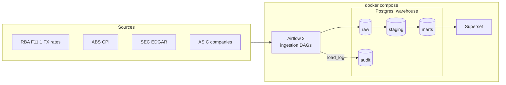

# AU Risk & Governance Data Platform

A local data platform that ingests Australian and US public data, models it with dbt, and serves risk, audit and governance analytics. It covers three domains:

- **Revenue and financial performance:** company financials normalised to AUD
- **Fraud, AML and audit analytics:** transaction monitoring and procurement red flags
- **Insurance and data governance:** claims trends, data contracts, lineage and PII controls

> Status: **v0.1 in progress** (Month 1, the platform spine). See the [milestones](https://github.com/CheruiyotJoyline/AU-Risk-Governance-Data-Platform/milestones).

## Architecture (v0.1)



| Layer   | Built with                                 | Status   |
|---------|--------------------------------------------|----------|
| Ingest  | Airflow 3 (TaskFlow API), Python, psycopg2 | RBA FX done; ABS, EDGAR, ASIC next |
| Store   | Postgres 17, four schemas, three roles     | done     |
| Model   | dbt, run by Astronomer Cosmos              | week 3–4 |
| Serve   | Superset                                   | week 4   |
| Guard   | pre-commit, GitHub Actions                 | done     |

Design decisions are recorded in [docs/adr](docs/adr).

## Run it locally

You need Docker (Docker Desktop, OrbStack or Colima) with at least 4 GB of memory, and Python 3.12 for local tooling.

```bash
git clone https://github.com/CheruiyotJoyline/AU-Risk-Governance-Data-Platform.git
cd AU-Risk-Governance-Data-Platform
make env     # creates .env with random passwords
make up      # builds the Airflow image and starts the stack
make ps      # wait until every service shows "healthy"
```

Then:

1. Open Airflow at http://localhost:8080. The username is `admin`, and the password is `AIRFLOW_ADMIN_PASSWORD` in `.env`.
2. Unpause `rba_fx_daily` and trigger it.
3. Check the result:

```bash
make psql
```
```sql
select series_id, count(*), max(rate_date) from raw.rba_fx_daily group by 1 order by 1;
select * from audit.load_log order by load_id desc limit 5;
```

Trigger the DAG again: `load_log` should show 0 rows inserted and 0 updated.

| Command      | What it does                                      |
|--------------|---------------------------------------------------|
| `make up`    | Build and start the stack                         |
| `make down`  | Stop the stack, keep data                         |
| `make reset` | Stop the stack and delete all data                |
| `make logs`  | Follow logs                                       |
| `make psql`  | psql into the warehouse                           |
| `make test`  | Run unit tests                                    |
| `make lint`  | Run all pre-commit hooks                          |

## Develop

```bash
python3.12 -m venv .venv && source .venv/bin/activate
pip install -r requirements-dev.txt
pre-commit install
make test
```

`main` is protected: all changes go through a pull request, and CI must pass before merging.

## Repository layout

```
dags/                 Airflow DAGs, kept thin: they schedule, ingestion/ does the work
ingestion/            Python ingestion code, importable and unit-tested without Airflow
  common.py           download, row hashing, DDL runner, audit.load_log writer
  rba/fx.py           RBA F11.1 parser and upsert
  sql/                idempotent DDL for raw and audit tables
docker/
  airflow/            Airflow image and extra requirements
  postgres/init/      first-start script: databases, schemas, roles, grants
docs/adr/             architecture decision records
tests/                pytest unit tests and fixtures
data/landing/         downloaded source files (git-ignored)
```

## Data sources

| Source | Licence | Cadence | Used for |
|--------|---------|---------|----------|
| [RBA F11.1 exchange rates](https://www.rba.gov.au/statistics/tables/) | [RBA copyright and disclaimer](https://www.rba.gov.au/copyright/) | Business days | AUD normalisation |

More sources are added here as their DAGs land.
